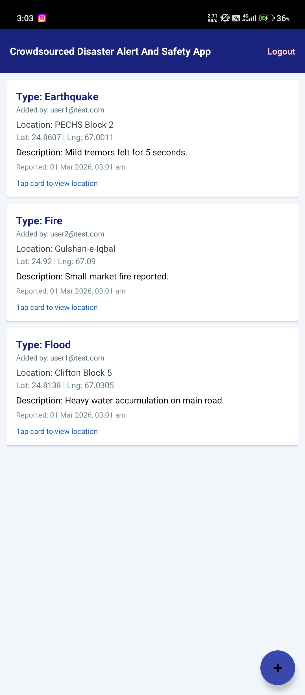
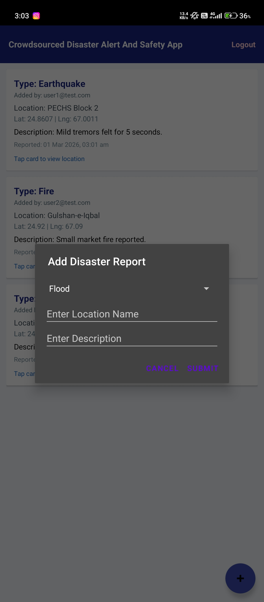

# Crowdsourced Disaster Alert and Safety App

Android app where people can report disasters (flood, fire, earthquake) from their location, and other users can confirm or dismiss those reports. I built this as my final year project (CS619) at Virtual University of Pakistan.

## What it does

- Sign up / login with Firebase Authentication
- Submit a disaster report with type, location name, description and GPS coordinates (optional media link)
- Live list of reports from Cloud Firestore, tap a card to open the location in Google Maps
- Community voting on each report (Confirm / Dismiss). Status shows as Verified, Fake or Pending depending on votes
- SOS button that sends the user's current location to the `sos_alerts` collection
- Admin panel (restricted by Firebase UID) to review reports and SOS alerts and approve / reject reports
- Push notifications using Firebase Cloud Messaging, plus a Firestore listener that notifies when a new report comes in

## Screenshots

| Login | Reports | Add report |
|---|---|---|
|  |  |  |

## Tech used

Java, Android SDK (min SDK 23), Firebase Auth, Cloud Firestore, Firebase Cloud Messaging, Google Play Services Location, Google Maps, RecyclerView / CardView.

Firestore collections: `users`, `disaster_reports`, `sos_alerts`.

## Running it

1. Clone the repo and open the `DisasterAlertApp` folder in Android Studio.
2. Create your own Firebase project, add an Android app with package name `com.example.disasteralertapp`, and download `google-services.json` into `DisasterAlertApp/app/` (see `google-services.json.example` for the shape). Enable Email/Password auth and Firestore.
3. Put your own Google Maps API key in `app/src/main/res/values/strings.xml` (`google_maps_key`).
4. Put your admin account's Firebase UID in `AdminConfig.java` if you want to use the admin panel.
5. Run on an emulator or a phone.

The real keys are not in this repo on purpose.

## Known limitations

This is a prototype, so a few things are not production ready:

- The "already voted" check is stored locally in SharedPreferences, so clearing app data lets a user vote again. It should be stored per user in Firestore.
- Admin access is checked in the app using a UID list. Real protection needs proper Firestore security rules.
- Reports are only moderated manually by admins.

## Author

Muhammad Shakir Karim, BSCS final year, Lahore.
GitHub: [BuildWithShakirr](https://github.com/BuildWithShakirr)
